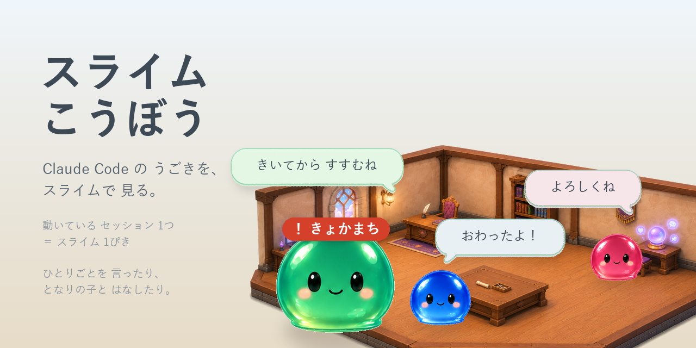

# スライムこうぼう



Claude Code の裏側で いま なにが 起きているかを、
**スライムが 働く すがた**で 見せる 道具です。

- 動いている セッション 1つ ＝ スライム 1ぴき
- 道具を つかうと しごとを 引きうけ、終わると よろこぶ
- 手が 空くと おしゃべりし、静かになると 寝る
- **許可を 待って 止まっている子**は 赤い名札で 机の前に ならぶ
- **会話が のびすぎた部屋**の子は ぐったりして、引っこしを すすめてくる

## 入れかた

**Claude Code に つぎのように たのむ だけ**です。
コマンドを 打つ 必要は ありません。

> スライムこうぼう を 入れて ください。
> `claude plugin marketplace add nekozuki0627/slimekoubou` と
> `claude plugin install slime-koubou@arillo` を 実行して、
> そのあと ちゃんと 立ち上がったか 確かめて ください。

自分で 打ちたい人は、ターミナル（Windows は PowerShell）で この 2行です。

```
claude plugin marketplace add nekozuki0627/slimekoubou
```
```
claude plugin install slime-koubou@arillo
```

> ⚠️ Claude の 入力欄に `/plugin …` と 打つ やりかたは
> **デスクトップアプリでは 使えません**
> （`/plugin isn't available in this environment.` と 出ます）。
> 上の `claude plugin …` なら、どの つかい方でも 通ります。

そのあと Claude Code を 開きなおすと、**工房は ひとりでに 立ち上がります**。
ブラウザで <http://127.0.0.1:8899/> を ひらくと 部屋が 見られます。

python が 入っていれば ほかに 用意するものは ありません。
入っていない時は、開きなおした 時に その旨を お知らせします
（<https://www.python.org/downloads/> から 入れてください。
Windows は 入れる時の「Add python.exe to PATH」に チェックを 入れてください）。

## スマホで 見る

**この 道具は、出先で ちらっと 見るのが 本番です。**
スマホから 見られるように するところまでを ひとまとめに 書きます。

### 1. アプリを 入れる（Android）

**[→ アプリを ダウンロード](https://github.com/nekozuki0627/slimekoubou/releases/latest)**

`.apk` を スマホで ひらいて 入れます。
Android の「不明な アプリの インストール」を 許可する 必要が あります。
Android 8.0 以上で 動きます。

### 2. Tailscale を 入れる

**PC と スマホの 両方**に [Tailscale](https://tailscale.com/) を 入れて、
同じ アカウントで ログインします。

同じ WiFi の 中だけなら なくても つながりますが、
それだと **家を 出た とたんに 見られなく なります**。
外で 見られてこそ の 道具なので、ここは 入れて ください。

Tailscale を 入れると、**家でも 外でも 同じ 住所 ひとつ**で つながります。
つなぎ先を 切りかえる 手間は ありません。

### 3. QR で つなぐ

工房の 画面の 右上（歯車）から「スマホで見る」で QRが 出ます。
スマホの ふつうの カメラで 読むと、住所と 合言葉が そのまま 入ります。

### 住人と 部屋を えらぶ（スマホ）

アプリの 設定画面で、見た目を 変えられます。

- **住人の すがた** … スライム／ねこ／ことり。
  ねこ・ことりは、スライムの 色ちがいと 同じように **部屋ごとに ちがう 柄の 子**が 住みます
  （ねこ8柄・ことり8柄。歩きかたは 本物に 合わせています）
- **部屋** … 魔法の工房／冒険者ギルド／和室／森のツリーハウス／宇宙船／夜の図書館／パステルカフェ

> PC の ブラウザで 見る 部屋は、いまは スライムと 魔法の工房だけです。

### iPhone で 見る（おためし）

iPhone は 壁紙に できないので、**ウィジェット**で 出します
（ロック画面・ホーム画面に「きょかまち」の 子が 出しっぱなしに なります）。

1. iPhone に [Scriptable](https://apps.apple.com/app/scriptable/id1405459188)（無料）と Tailscale を 入れる
2. iPhone の Safari で `http://<PCの住所>:8899/iphone?t=<合言葉>` を ひらく
   （工房の 画面の アドレスの `/?t=` を `/iphone?t=` に 変えるだけ）
3. 「台本を コピーする」→ Scriptable に 貼って、ウィジェットを 置く

> iPhone の ウィジェットは iOS の つごうで **数分〜15分おき**にしか 書きかわりません。

## やり残しを 部屋の外に 出す

`todo.md` の ような 台帳に、**自分でないと できないこと**を 書いておくと、
部屋の まわりに 一覧で 出ます。

```markdown
- [ ] クラウドの ゴミ箱を 空にする @me #けいり
```

- `- [ ]` が 空いていて **`@me`** が 付いた 行だけ 出ます
- `#うしろ` は どの しごとの ものか（なくても よい）
- 終わったら `- [x]` に。画面の ✓ を 押しても 同じです
- スマホでは 部屋の下に「📋 タスク ◯件」の ボタンが 出ます。押すと 一覧が ひらき、
  🔴 が 付いた 急ぎは いちばん上、のこりは 部屋ごとに たたんで 出ます。✓ で「済み」に できます
- ✓ で 済みに すると、台帳の 行に「← 日時 スマホでチェック（済み）」と 書き足されます

台帳の 置き場と 印は、工房の 設定（`_config.json` の `todo_file` / `todo_mark`）で
変えられます。`done_log` に ファイルを 指定すると、✓ で 済みに した ことを
そこにも 1行 のこします（ほかの Claude Code の 部屋が「もう 済んだ」と 分かるように）。

## 部屋の 引っこし

会話が のびると、Claude は 毎回 それまでの 全部を 読み直すので、
だんだん 重くなり、しまいには 返事が 返らなくなります。

工房は それぞれの 部屋の **会話の数**と **記録の大きさ**を 数えていて、
重くなった 部屋の スライムは **ぐったりした すがた**に なります。
その部屋の Claude 自身にも 知らせが 行くので、区切りの ところで
「そろそろ 新しくしよう」と 声を かけてきます。

- 目安 … 会話 3,000件 か 80MB の どちらか 重い方
- 「げんき」か「よわり」の 2つだけ。こまかい 段階は 出しません

### 引っこしの しかた

**あなたが やるのは「OK」と 返すだけ**です。新しい セッションを 作ったり、部屋を 切りかえたり、アーカイブを 押したりは しません。

1. よわった部屋の Claude が、区切りの ところで「そろそろ 新しくしよう。OKなら『OK』と 返してね」と 声を かけます（1回だけ。断れば もう 言いません）
2. 「OK」と 返すと、Claude が これまでの 経緯を `引きつぎ_<部屋の名まえ>.md` に 書き出して、引っこし先を 決めます
   - **スマホの 遠あやつりで 使っていない 部屋** … その部屋の 会話だけを まっさらにします（名まえは そのまま）。つぎの 一言から、軽くなった 部屋で 引きつぎを 読んで つづきを やります
   - **遠あやつりで 使う 部屋**（まっさらに できない） … 空き部屋「よび◯」に 引きつぎを たのみます
     - ⚠️ この 空き部屋は **パソコンで 作った もの**に 限ります。定期タスクで 作った 部屋は スマホの 一覧に 出ないため、出先から 話しかけられません。
       空き部屋が 無い 時だけ「パソコンの 前に 来たら『よび◯』を 1つ 作っておいて」と お願いが 来ます
     - パソコンだけで 使う 部屋なら、空き部屋が 無くても Claude が 定期タスク `yobi-heya`（手動のみ）を 実行して **自分で 作ります**
3. 空き部屋は 名まえを 引きつぎ、もとの部屋を 閉じて、あなたに「引きついだよ」と 知らせます。閉じられなかった 部屋は 無理に 閉じず、あとで まとめて 片づけます
4. スマホの 一覧は 名まえが 変わらないので、部屋の外の 一覧に「スマホで『よび◯』を 長押しして 名まえを 変える」と 出ます（✓で 消せます）

⚠️ 時間で 自動に 立つ 部屋（定期タスク）は、引っこし先に なりません（引きつぎの 横取りを 防ぐため）。

## 中身

| ファイル | なに |
|---|---|
| `monitor.py` | 工房のサーバー（ポート 8899）。ようすを 数えて 配る |
| `index.html` | 部屋の 画面 |
| `hooks/hooks.json` | Claude Code から ようすを 受けとる 配線 |
| `hooks/start.sh` | 工房を ひとりでに 立ち上げる |
| `sheet_*.png` `room_cut.png` | スライムと 部屋の 絵 |

外の世界には 何も 送りません。ようすは この PC の 中だけで やりとりします。
スマホから 見る時も、同じ WiFi か Tailscale の 中だけを 通ります。

作：Arillo Design
